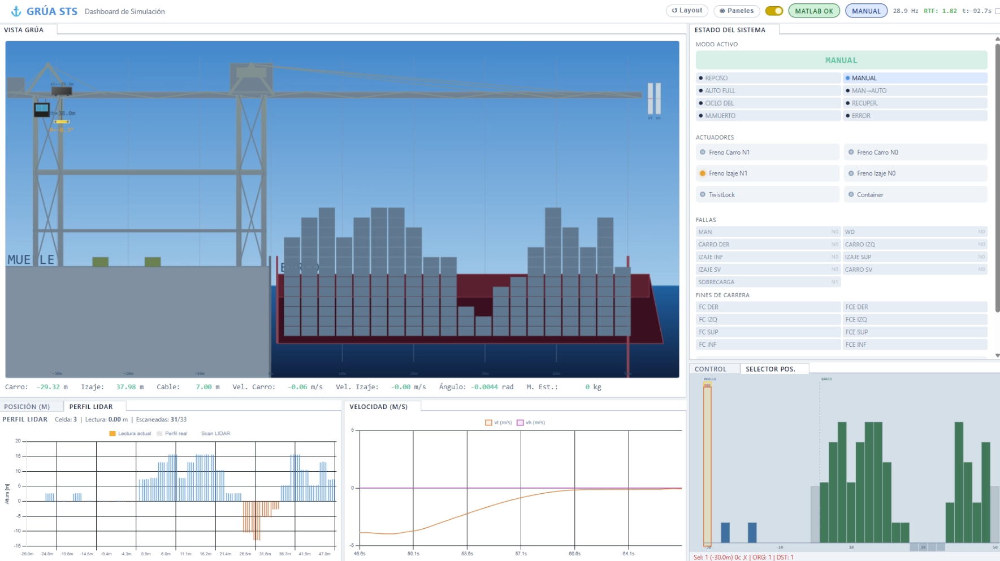
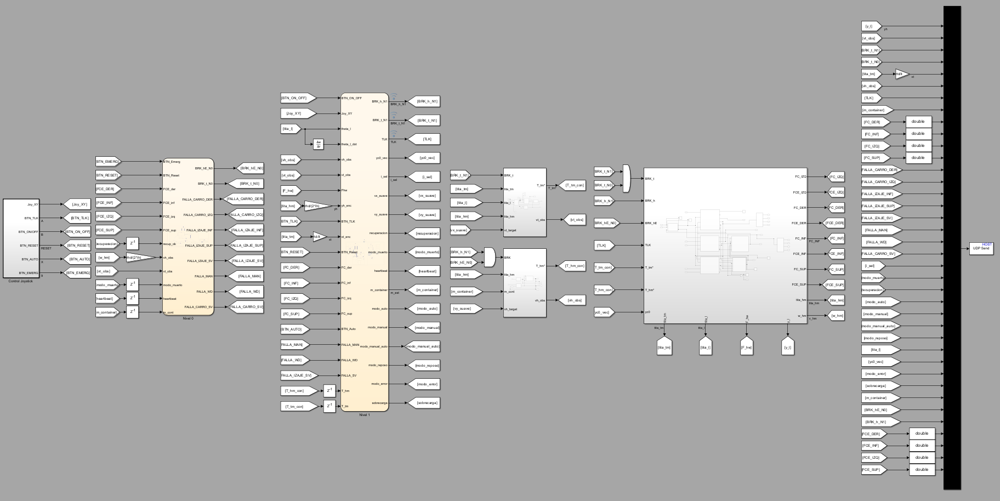

# Grúa STS — Simulador de Control Discreto

Proyecto final de la materia **Autómatas y Control Discreto** (10° semestre, UNCUYO 2025).

Simulación completa de una grúa portacontenedores tipo **Ship-to-Shore (STS)**: modelo físico en MATLAB/Simulink/Stateflow + dashboard web en Python para visualización y control en tiempo real.

---

## Dashboard


*Vista en modo manual: animación 2D de la grúa, perfil de obstáculos LIDAR, telemetría y selector de posición.*


*Vista en modo automático: el autómata ejecuta la misión de mover un contenedor de origen a destino.*

---

## ¿Qué simula?

La grúa STS mueve contenedores entre un barco y el muelle. Tiene dos ejes de movimiento:

- **Carro (trolley):** traslación horizontal sobre la viga
- **Izaje (hoist):** subida y bajada del spreader con la carga

La carga cuelga como un péndulo → los ejes están acoplados dinámicamente.

---

## Arquitectura de control

El sistema implementa **3 niveles de control en cascada**:

| Nivel | Ts | Rol |
|---|---|---|
| **L2** — Regulatorio | 1 ms | Observador Luenberger + PI trapezoidal. Controla velocidad de carro e izaje, compensa balanceo. |
| **L1** — Supervisor | 20 ms | Autómata Stateflow principal. Gestiona modos de operación (manual, automático, recuperación, error). |
| **L0** — Seguridad | 20 ms | Watchdog, límites de posición/velocidad, freno de emergencia NC. Sobrescribe a L1 y L2. |

---

## Modelo físico (Simulink)


*Modelo Simulink de la planta: dinámica del carro, izaje, péndulo, contacto con containers y LIDAR virtual.*

La planta incluye:
- Dinámica de 2 masas (motor + carro, motor + tambor de izaje) acopladas por cables elásticos
- Balanceo de carga como péndulo de longitud variable
- Frenos normalmente cerrados (NC) con modelo `tanh`
- LIDAR virtual 1D: escanea el perfil de obstáculos (33 celdas de 2.44 m)
- Contacto con containers (twistlocks)

---

## Cómo correr

### Requisitos
- MATLAB R2025b con Simulink, Stateflow y Instrument Control Toolbox
- Python 3.10+ con entorno virtual en `venv/`

### Setup MATLAB
```matlab
cd simulink
run('init_plant_parameters.m')   % siempre primero
run('planta.slx')
```

### Dashboard Python
```bash
venv\Scripts\python run_dashboard.py          # modo normal (con MATLAB)
venv\Scripts\python run_dashboard.py --sim-test  # modo prueba sin MATLAB
```

Abrir `http://localhost:5000` en el navegador.

### Instalar dependencias Python
```bash
venv\Scripts\pip install flask flask-socketio watchdog vgamepad pygame
```

> **Nota:** el joystick virtual requiere [ViGEm Bus Driver](https://github.com/ViGEm/ViGEmBus/releases) instalado en Windows.

---

## Estructura del proyecto

```
simulink/          → modelos Simulink (.slx) y scripts MATLAB
dashboard/         → backend Flask + SocketIO, frontend canvas 2D
codesys/           → proyecto CODESYS 3.5 (PLC virtual vía UDP)
informe/           → informe LaTeX del proyecto
presentacion/      → presentación LaTeX Beamer
```

---

**UNCUYO — Ingeniería en Mecatrónica — 2025**
