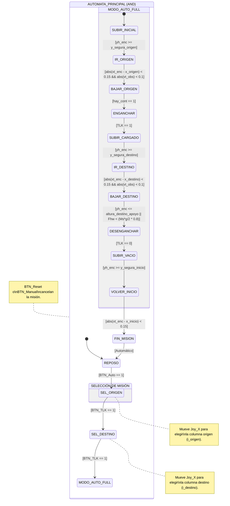

# Implementación: Modo Automático 100% (Full Auto) — Chart "Control Nivel 1"

> Referencia para implementar manualmente en Stateflow.  
> Archivo: `simulink/nivel_1.slx` → Chart → AUTOMATA_PRINCIPAL

---

## Diagrama de estados (100% Automático)



---

## Paso 1 — Variables nuevas en el chart

Abrir Chart → Model Explorer → Chart → agregar o modificar cada variable:

| Nombre             | Scope     | Tipo   | Puerto | Valor inicial |
|--------------------|-----------|--------|--------|---------------|
| `i_lista`          | Parameter | double | —      | (del workspace)|
| `BTN_Auto`         | Input     | double | **15** | —             |
| `i_sel`            | Local     | double | —      | `1`           |
| `i_origen`         | Local     | double | —      | `1`           |
| `i_destino`        | Local     | double | —      | `1`           |
| `x_origen`         | Local     | double | —      | `0`           |
| `x_destino`        | Local     | double | —      | `0`           |
| `x_inicio`         | Local     | double | —      | `0`           |
| `cmd_auto_tlk`     | Local     | double | —      | `0`           |
| `y_obj`            | Local     | double | —      | `0`           |
| `altura_apoyo`     | Local     | double | —      | `0`           |

> `cmd_auto_tlk` servirá para comandar los twistlocks desde el código sin que el operador presione el botón físico.

---

## Paso 2 — Estados de Selección

**SEL_ORIGEN**
```matlab
entry:
  i_sel = 1; debounce = 0;
  x_inicio = xt_enc; % Guardamos dónde estaba la grúa para volver
  x_origen = xt_min + (i_lista(1)-1)*Wc + Wc/2;
during:
  debounce = debounce + 1;
  if (debounce > 25)
    if (Joy_CMD_X > dead_zone)
      i_sel = mod(i_sel, length(i_lista)) + 1; debounce = 0;
    elseif (Joy_CMD_X < -dead_zone)
      i_sel = mod(i_sel-2, length(i_lista)) + 1; debounce = 0;
    end
  end
  x_origen = xt_min + (i_lista(i_sel)-1)*Wc + Wc/2;
exit:
  i_origen = i_lista(i_sel);
```

**SEL_DESTINO** (Transición desde SEL_ORIGEN: `[BTN_TLK == 1]`)
```matlab
entry:
  i_sel = 1; debounce = 0;
  x_destino = xt_min + (i_lista(1)-1)*Wc + Wc/2;
during:
  % (Misma lógica de selección con el joystick)
  debounce = debounce + 1;
  if (debounce > 25)
    if (Joy_CMD_X > dead_zone)
      i_sel = mod(i_sel, length(i_lista)) + 1; debounce = 0;
    elseif (Joy_CMD_X < -dead_zone)
      i_sel = mod(i_sel-2, length(i_lista)) + 1; debounce = 0;
    end
  end
  x_destino = xt_min + (i_lista(i_sel)-1)*Wc + Wc/2;
exit:
  i_destino = i_lista(i_sel);
```

---

## Paso 3 — Estado MODO_AUTO_FULL (Ejecución 100% Autónoma)

```matlab
entry:
  modo_auto = 1;
  BRK_t_N1 = 1; BRK_h_N1 = 1;
exit:
  modo_auto = 0;
```

### 3.1 Ir a buscar el contenedor
**SUBIR_INICIAL**
```matlab
entry:
  % Calcular y_segura_origen buscando obstáculos entre i_carro e i_origen
  y_max_ruta = 0;
  for k = min(i_carro,i_origen):max(i_carro,i_origen)
    if yc0_vec(k) > y_max_ruta
      y_max_ruta = yc0_vec(k);
    end
  end
  y_segura_origen = min(y_max_ruta + Hc + 1.0, yh_max - 1.0);
during:
  vx_target = 0;
  vy_target = vh_lim;
```
*(Sale cuando `[yh_enc >= y_segura_origen]`)*

**IR_ORIGEN**
```matlab
during:
  err_x = x_origen - xt_enc;
  vx_target = max(-vt_max, min(vt_max, 3.0*err_x));
  vy_target = 0;
```
*(Sale cuando `[abs(xt_enc - x_origen) < 0.15 && abs(vt_obs) < 0.1]`)*

**BAJAR_ORIGEN**
```matlab
entry:
  y_obj = yc0_vec(i_origen) + 0.5; % Altura donde debería estar el contenedor
during:
  err_y = y_obj - yh_enc;
  vy_target = max(-vh_lim, min(vh_lim, 3.0*err_y));
  vx_target = 0;
```
*(Sale cuando `[hay_cont == 1]` o por sensor de proximidad/contacto)*

**ENGANCHAR**
```matlab
entry:
  vy_target = 0;
  cmd_auto_tlk = 1; % Simulamos que apretamos el botón
exit:
  cmd_auto_tlk = 0;
```
*(Sale cuando `[TLK == 1]`)*

---

### 3.2 Trasladar y dejar
**SUBIR_CARGADO**
```matlab
entry:
  % Calcular y_segura_destino basado en perfil
  y_max_ruta = 0;
  for k = min(i_origen,i_destino):max(i_origen,i_destino)
    if yc0_vec(k) > y_max_ruta
      y_max_ruta = yc0_vec(k);
    end
  end
  y_segura_destino = min(y_max_ruta + Hc + 1.0, yh_max - 1.0);
during:
  vy_target = vh_lim;
  vx_target = 0;
```
*(Sale cuando `[yh_enc >= y_segura_destino]`)*

**IR_DESTINO**
```matlab
during:
  err_x = x_destino - xt_enc;
  vx_target = max(-vt_max, min(vt_max, 3.0*err_x));
  vy_target = 0;
```
*(Sale cuando `[abs(xt_enc - x_destino) < 0.15 && abs(vt_obs) < 0.1]`)*

**BAJAR_DESTINO**
```matlab
entry:
  altura_apoyo = yc0_vec(i_destino) + Hc + 0.5; % Donde lo va a apoyar
during:
  err_y = altura_apoyo - yh_enc;
  vy_target = max(-vh_lim, min(vh_lim, 3.0*err_y));
```
*(Sale cuando `[yh_enc <= altura_apoyo || Fhw < (Ms*g/2 * 0.8)]`)*

**DESENGANCHAR**
```matlab
entry:
  vy_target = 0;
  cmd_auto_tlk = 1; % Mandamos a abrir
exit:
  cmd_auto_tlk = 0;
```
*(Sale cuando `[TLK == 0]`)*

---

### 3.3 Volver al inicio
**SUBIR_VACIO**
```matlab
entry:
  y_max_ruta = 0;
  for k = min(i_destino,i_carro):max(i_destino,i_carro) % i_carro era inicial
    if yc0_vec(k) > y_max_ruta
      y_max_ruta = yc0_vec(k);
    end
  end
  y_segura_inicio = min(y_max_ruta + Hc + 1.0, yh_max - 1.0);
during:
  vy_target = vh_lim; % Subir a posición segura
```
*(Sale cuando `[yh_enc >= y_segura_inicio]`)*

**VOLVER_INICIO**
```matlab
during:
  err_x = x_inicio - xt_enc;
  vx_target = max(-vt_max, min(vt_max, 3.0*err_x));
  vy_target = 0;
```
*(Sale cuando `[abs(xt_enc - x_inicio) < 0.15]`)*

**FIN_MISION**
```matlab
entry:
  vx_target = 0;
  vy_target = 0;
```
*(Transición directa de salida hacia `REPOSO` o termina auto).*

---

## 4. Conectar `cmd_auto_tlk` con el estado paralelo `TWISTLOCKS`

Para que el estado paralelo que maneja los twistlocks responda al modo automático, debemos modificar las transiciones del estado `TWISTLOCKS` para que reaccionen a la nueva señal `cmd_auto_tlk` *además* del botón físico `BTN_TLK`:

* En la transición `VACIO -> CERRANDO_TLK`: 
  `[(BTN_TLK == 1 || cmd_auto_tlk == 1) && ...]`
* En la transición `CARGADO -> ABRIENDO_TLK`:
  `[(BTN_TLK == 1 || cmd_auto_tlk == 1) && ...]`
